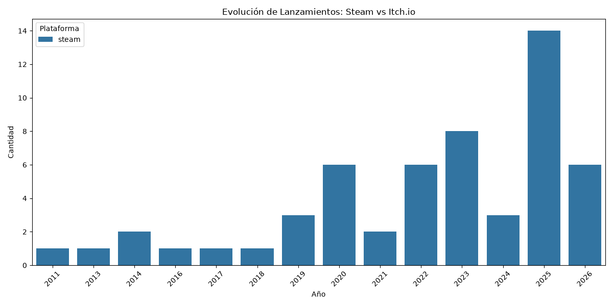
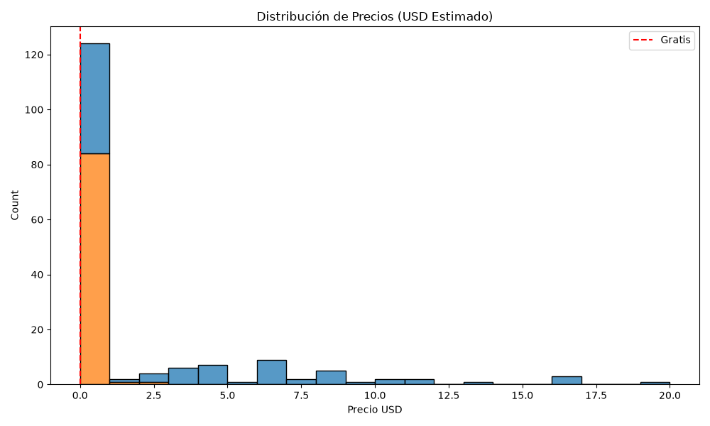
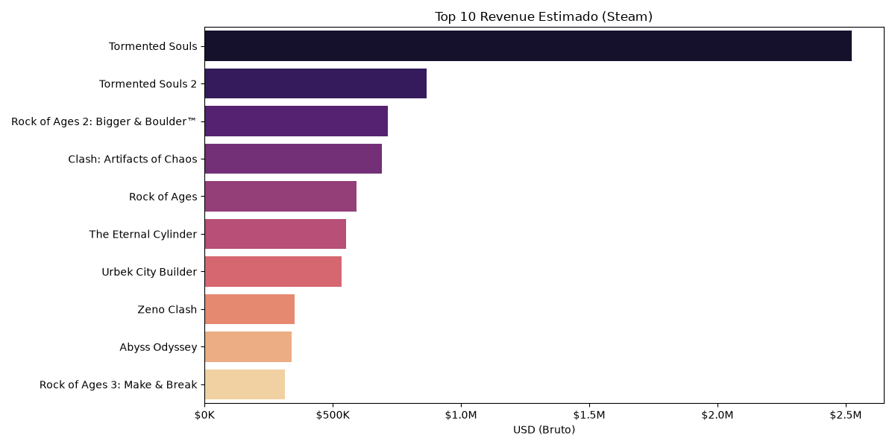

# Chilean Video Games Market Analysis

[](https://github.com/alvarosalinaso/chilean-videogames-analysis/actions/workflows/ci.yml) [](LICENSE) [](https://python.org)

<!-- BEGIN GENERATED: readme_numbers -->
> **Hallazgo principal:** de 170 juegos chilenos en Steam e Itch.io (84 Steam, 86 Itch.io), el género dominante es **Acción** (50 juegos, 29.4%) y la mediana de precio en Steam es **$2.00 USD**; el **88.2%** no tiene recomendaciones registradas (150 de 170).

### Hallazgos clave

| Métrica | Valor |
|---------|-------|
| Juegos en el dataset | 170 (84 Steam, 86 Itch.io) |
| Género dominante | Acción (50 juegos, 29.4%) |
| Categorías de género | 24 |
| Mediana de precio Steam | $2.00 USD |
| Steam gratis/pago | 46.4% gratis; mediana pago $6.74 |
| Itch.io con precio > 0 | 2 de 86 |
| Sin recomendaciones registradas | 150/170 (88.2%) |
| Años | 2009–2026 conocidos; 113 Unknown (66.5%) |
| HHI por género (primary_genre) | 1240.1, Competitivo (<1500) (24 categorías) |
| Revenue estimado Steam (Boxleiter) | 20x: $4,312,815 · 40x: $8,625,629 · 60x: $12,938,444 |
| Mayor revenue estimado (40x) | Tormented Souls ($2,522,494) |
| Precio vs recomendaciones (Steam) | r=-0.0437, p=0.855, p_Holm=1.000 (n=20, n.s.) |
| Precios Steam vs Itch.io (Welch t-test) | p<0.001, p_Holm<0.001 (significativo) |
| ANOVA revenue por género | p=0.602, p_Holm=1.000 (n.s.) |
| Corrección Holm-Bonferroni | 3 p-values ajustados |

*Cifras generadas por `python scripts/readme_numbers.py` sobre `data/export/chilean_games_final.csv`. Verificación: `python scripts/readme_numbers.py --check`.*
<!-- END GENERATED: readme_numbers -->



---

## What is this?

EN: There's no structured, reproducible data about the Chilean indie game market. This repo scrapes Steam and Itch.io, cleans the dataset, and analyzes pricing, genres, estimated revenue, and platform differences, every number in this README is generated by a script from the data in the repo.

ES: No hay datos estructurados y reproducibles sobre el mercado indie de videojuegos chilenos. Este repo hace scraping de Steam e Itch.io, limpia el dataset y analiza precios, géneros, revenue estimado y diferencias por plataforma, cada número de este README lo genera un script a partir de los datos del repo.

---

## Dataset

El dataset autoritativo es [`data/export/chilean_games_final.csv`](data/export/chilean_games_final.csv) (regenerado por `python -m chilean_videogames.analyze_all`). Las cifras clave están en la tabla de arriba, generada por `python scripts/readme_numbers.py`.

---

## Questions I asked

| ID | Question |
|----|----------|
| RQ1 | How have releases evolved by year and platform? |
| RQ2 | How do price distributions differ between Steam and Itch.io? |
| RQ3 | Which genres generate the most estimated revenue? |
| RQ4 | How concentrated is the market by genre (HHI)? |
| RQ5 | Is price correlated with recommendations on Steam, and how sensitive are revenue estimates to the Boxleiter factor (20x–60x)? |

---

## Qué mide y qué no

**Qué mide:**

- Juegos chilenos presentes en Steam (API `appdetails`) y en el tag `chile` de Itch.io (scraping HTML), con sus precios listados, géneros y reseñas (recommendations) de Steam.
- Revenue **estimado** con el método Boxleiter: `revenue = recommendations × factor × price` (factor base 40; el README reporta 20x/40x/60x).
- Concentración de mercado por género con el HHI calculado sobre `primary_genre` (incluye `Unknown` como categoría).

**Qué no mide:**

- Ventas ni ingresos reales: no hay datos de revenue real de Steam ni de Itch.io; toda cifra de revenue es una estimación proporcional al factor Boxleiter.
- Wishlists, tráfico, reseñas negativas/positivas (solo el conteo total de recommendations), calidad ni presupuesto.
- Itch.io no expone recommendations: su valor es `0` estructural, no "cero ventas".
- El universo completo del indie chileno: solo juegos todavía publicados en estas dos tiendas (sesgo de supervivencia) y en el tag curado de itch.io.
- Los nombres de género **no se traducen** entre plataformas: Steam entrega etiquetas localizadas (ej. `Acción`) y itch.io etiquetas en inglés (ej. `Action`), por lo que una misma categoría puede contar dos veces.

---

## Fuentes y licencias

- **Steam API** (`appdetails`): datos de tienda de Valve, uso analítico; no se redistribuye contenido de la API, solo los campos capturados por el scraper de este repo.
- **Itch.io** (tag `chile`): scraping HTML del listado general y del listado pagado (`/games/store/tag-chile`, único lugar donde aparecen precios).
- **Método Boxleiter**: heurística de la industria ("cada reseña ≈ 30–60 ventas"); este repo usa 40 como factor base y publica la sensibilidad 20x–60x.
- **Código de este repo**: MIT (ver [LICENSE](LICENSE)).
- Los datasets crudos (`data/raw/`) son snapshots de esas fuentes con derechos de sus titulares; se publican con fines de análisis.

---

## Visualizations





<details>
<summary><strong>Datawrapper, Revenue quadrant</strong> (visualización publicada antes del filtro de juegos no chilenos; los datos autoritativos son el CSV y la tabla generada)</summary>

<div style="position:relative;padding-bottom:56.25%;height:0;overflow:hidden;max-width:100%;">
  <iframe src="https://datawrapper.dwcdn.net/MBqIQ/" title="Revenue Quadrant" style="position:absolute;top:0;left:0;width:100%;height:100%;border:0;" loading="lazy" allowfullscreen></iframe>
</div>
</details>

---

## How to run

```bash
git clone https://github.com/alvarosalinaso/chilean-videogames-analysis
cd chilean-videogames-analysis
python -m venv .venv
source .venv/bin/activate          # Windows: .venv\Scripts\activate
pip install -r requirements.txt
pip install -r requirements-dev.txt
pip install -e .

python -m chilean_videogames.collect                 # Steam (requiere red)
python -m chilean_videogames.collect_itch            # Itch.io (requiere red)
python -m chilean_videogames.clean
python -m chilean_videogames.analyze_all
python -m chilean_videogames.export_visualizations

python scripts/readme_numbers.py --write             # regenera la tabla del README
python scripts/readme_numbers.py --check             # verifica que el README coincide
pytest                                               # tests (incluye la verificación del README)
```

Los módulos viven en `src/chilean_videogames/` y se ejecutan con `python -m` (paquete instalado en editable); `python src/collect.py` falla por los imports relativos del paquete. En Windows, `update_data.bat` ejecuta el pipeline completo.

---

## Limitations

- Revenue estimates depend entirely on the Boxleiter factor; see the 20x–60x sensitivity in the generated table (rankings do not change, only absolute amounts).
- The vast majority of titles have no recommendation data (see generated table); on Itch.io the field does not exist (structural zero).
- Genre labels mix Spanish (Steam) and English (Itch.io) and are not translated; the HHI and genre counts treat them as separate categories.
- Survival bias: only games still listed on the platforms are included.
- Year is unknown for a large share of Itch.io titles (see generated table).

---

## Related projects

- [Chile Geografía Histórica](https://github.com/alvarosalinaso/chile-geografia-historica), Interactive map of Chile's historical geography
- [Chilean Political Discourse + NLP](https://github.com/alvarosalinaso/geopolitica-textual-nlp), NLP on presidential speeches
- [Portfolio Web](https://github.com/alvarosalinaso/portfolio-web), Dashboard with all projects

---

> **Álvaro Salinas Ortiz**
> [LinkedIn](https://www.linkedin.com/in/alvaro-salinas-ortiz) | [Portfolio](https://alvarosalinaso.github.io/portfolio-web/)
